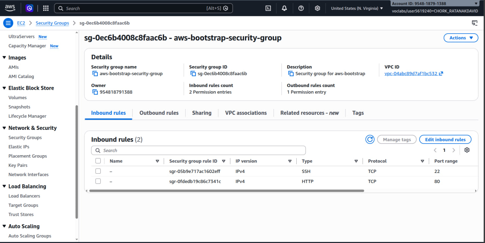
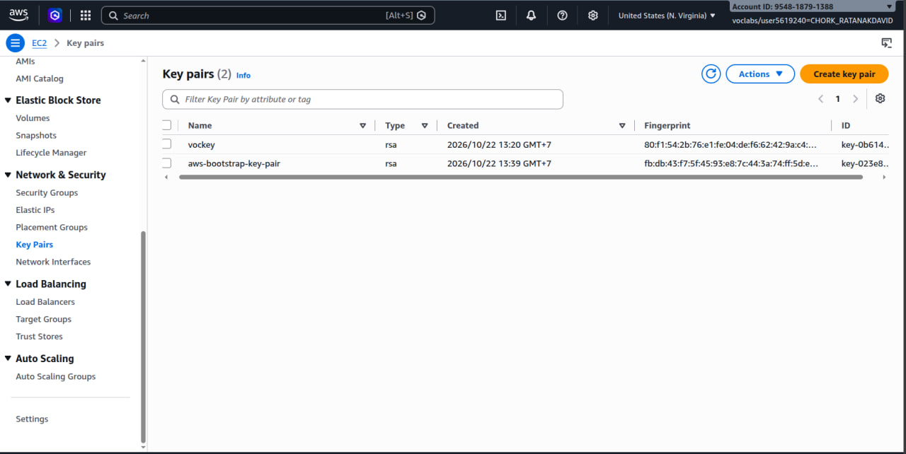
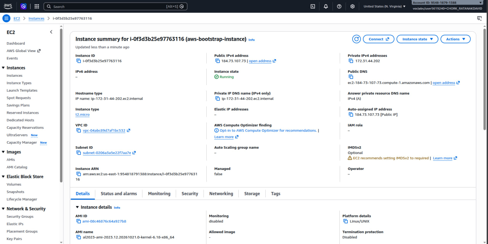
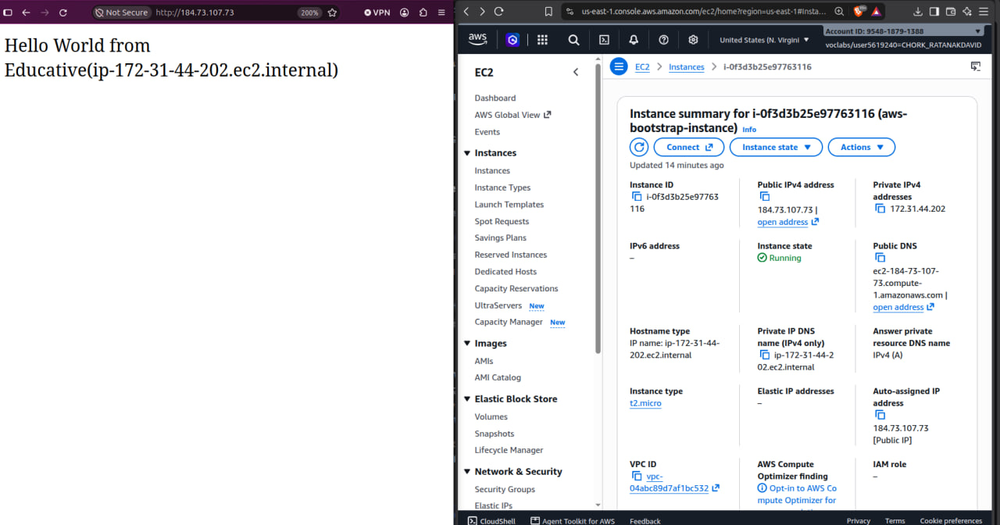
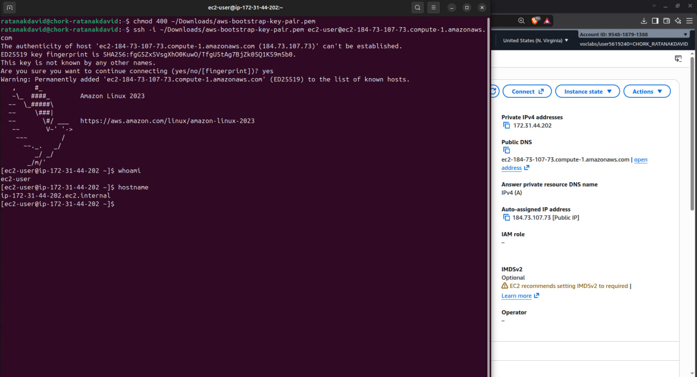
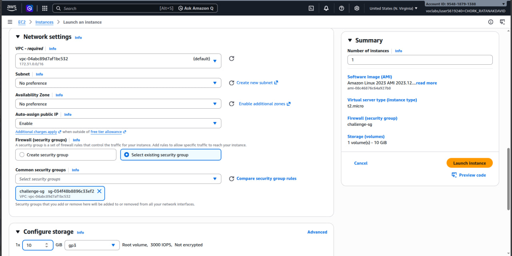
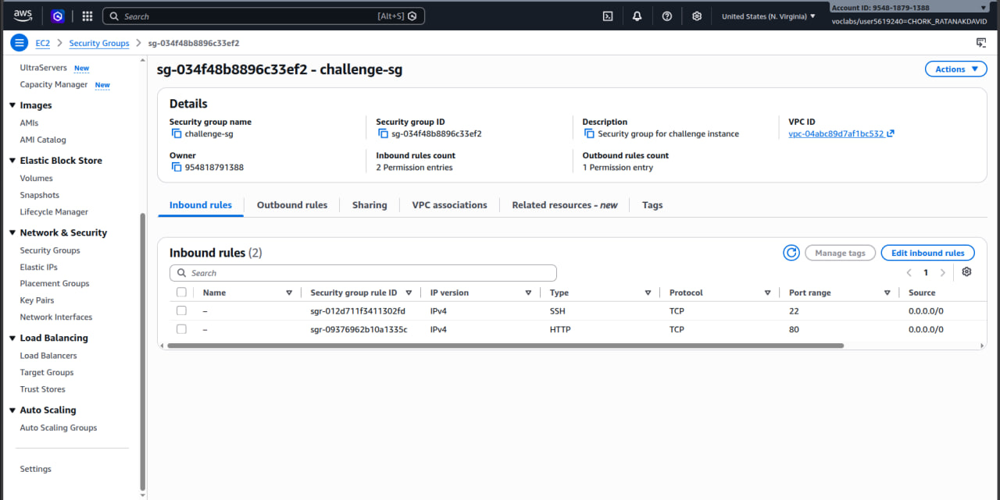
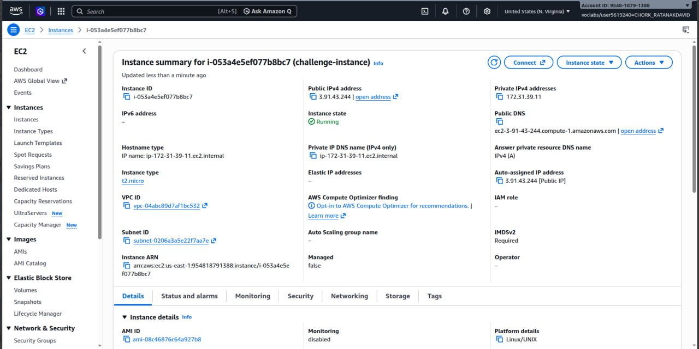
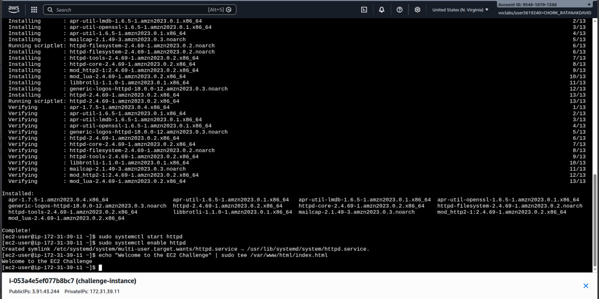
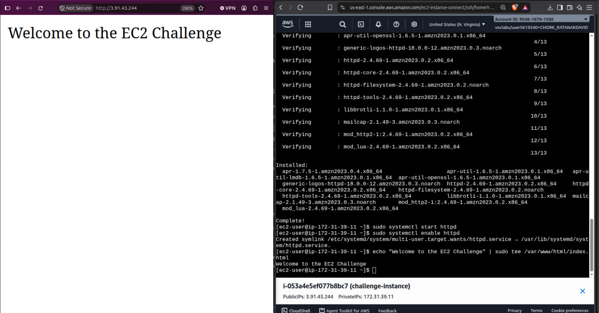

# Cloud Lab 1: Amazon EC2

**Student name:** CHORK RATANAKDAVID  
**Student ID:** e20221642  
**Learner Lab user name:** voclabs/user/5619240=CHORK_RATANAKDAVID  
**Date completed:** October 22, 2026

## Part 1.1: An Amazon EC2 Walkthrough

### Security group


### Key pair


### Instance details


### Browser test


### SSH connection


**Did you connect with your own SSH client or with EC2 Instance Connect?**
I connected with my own SSH client using Ubuntu.


## Part 1.2: EC2 Web Solution (Challenge)

### Launch configuration


### Security group


### Running instance


### Commands on the instance



**The command that ran to install the web server and create index.html:**
```bash
sudo dnf update -y
sudo dnf install -y httpd
sudo systemctl start httpd
sudo systemctl enable httpd
echo "Welcome to the EC2 Challenge" | sudo tee /var/www/html/index.html
```
### Browser test
