# Cloud Lab 2 Submission: Load Balancer and Auto Scaling

- **Student name:** CHORK RATANAKDAVID
- **Student ID:** e20221642
- **Learner Lab user name:** voclabs/user5619240=CHORK_RATANAKDAVID
- **Date completed:** November 5, 2026

## Security groups

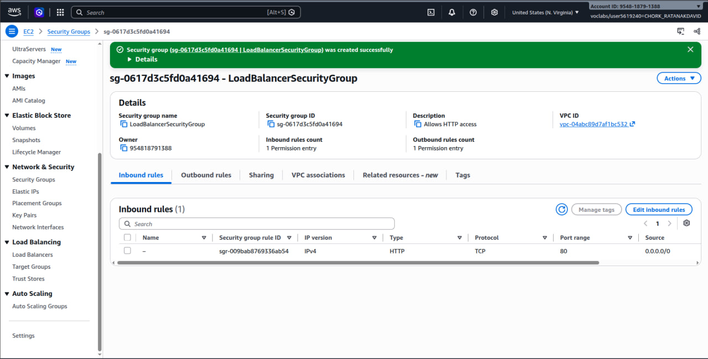

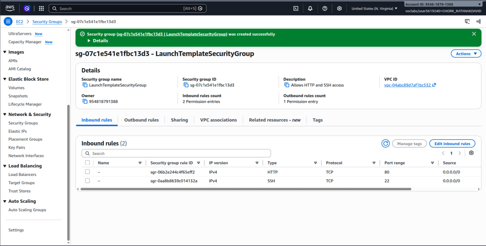

## Target group

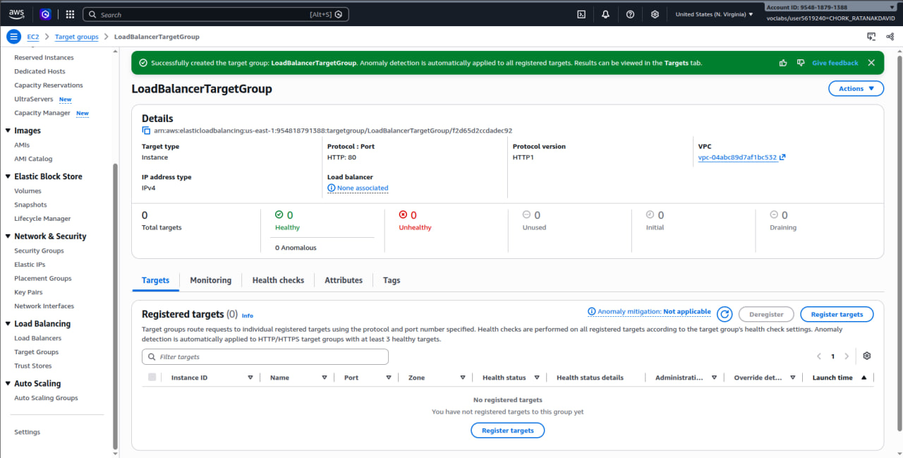

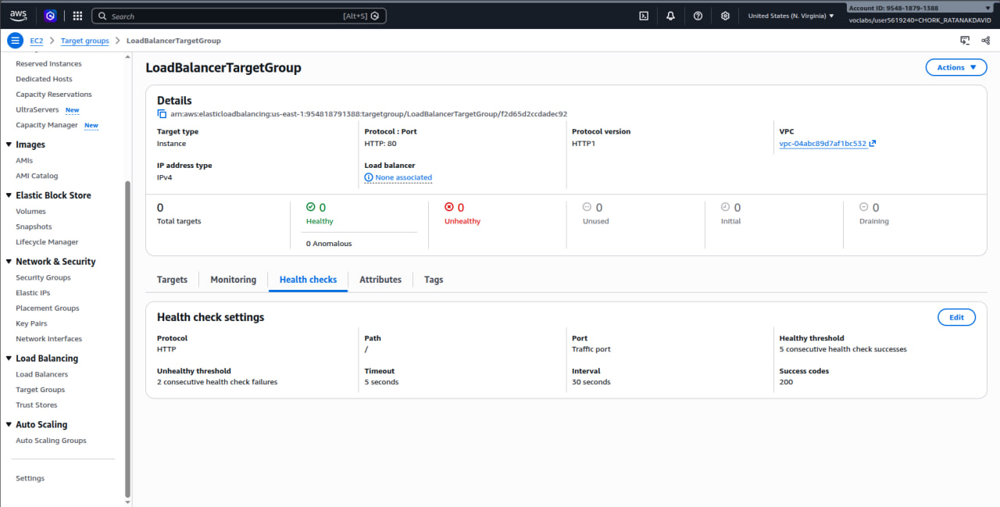

## Application Load Balancer

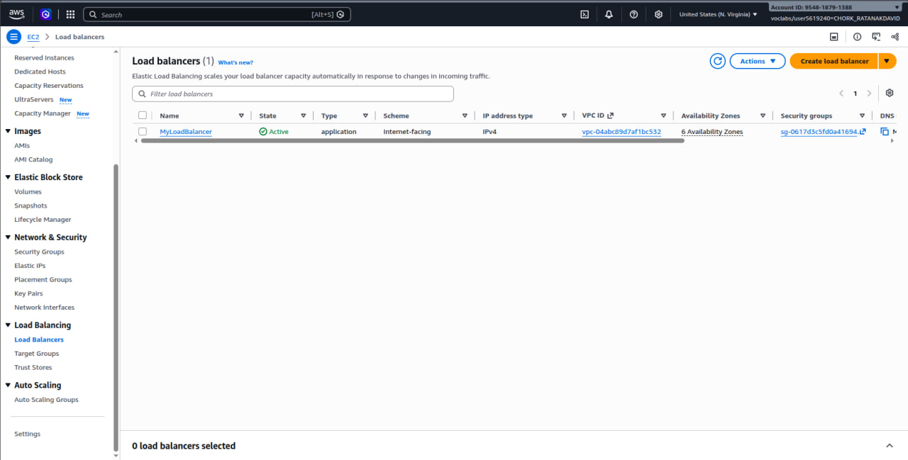

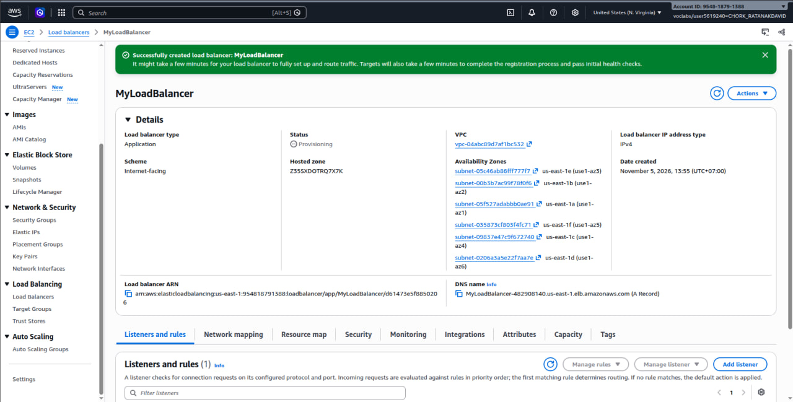

## Launch template

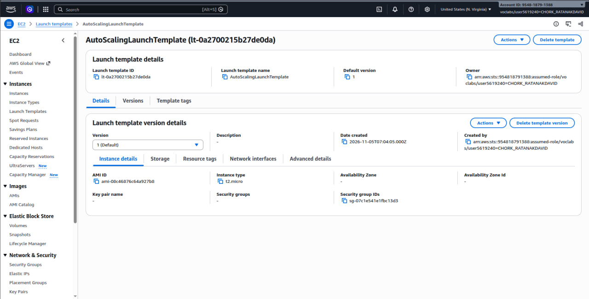

## Auto Scaling group

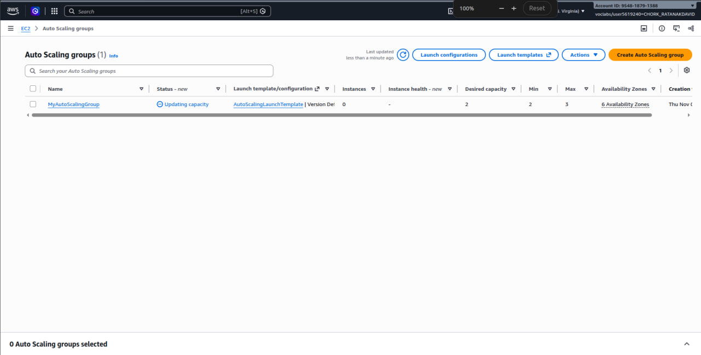

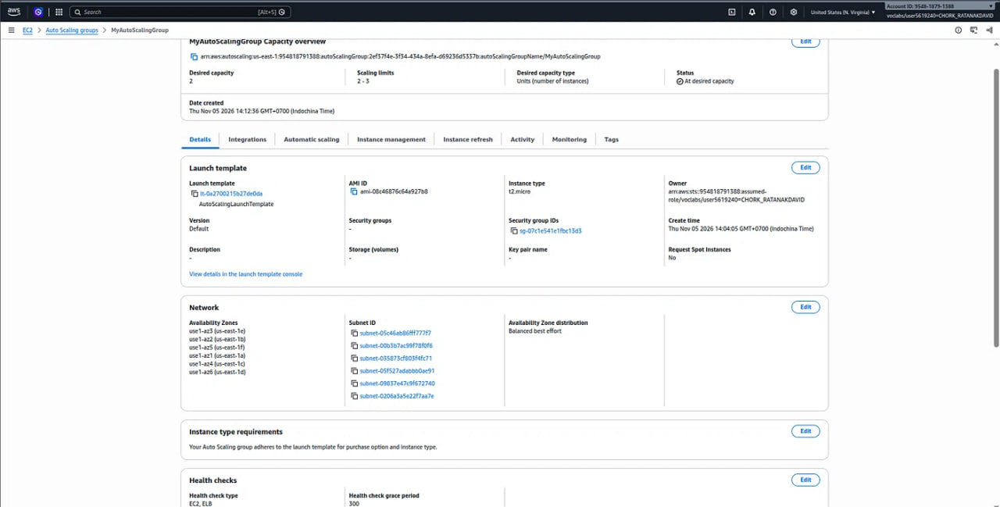

## Load balancing test

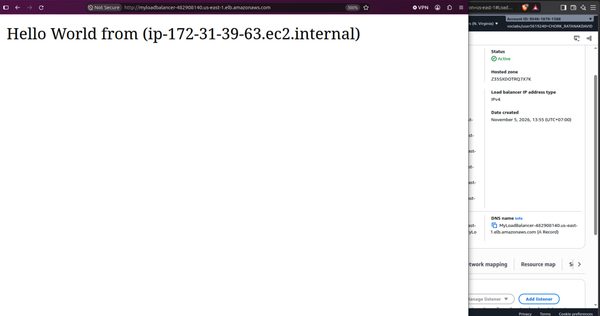

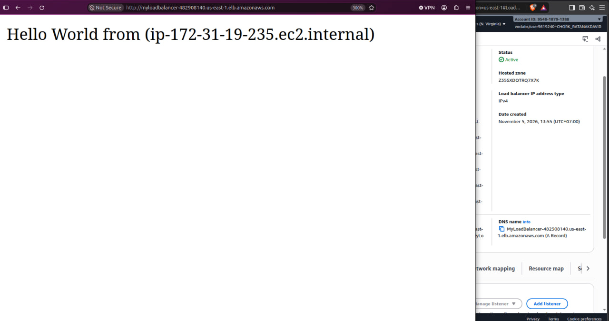

## Simulated application failure

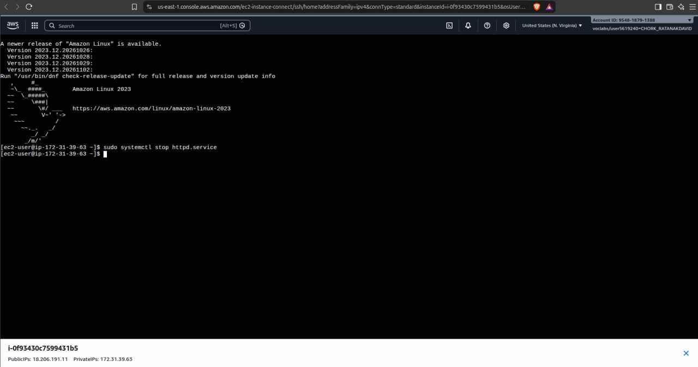

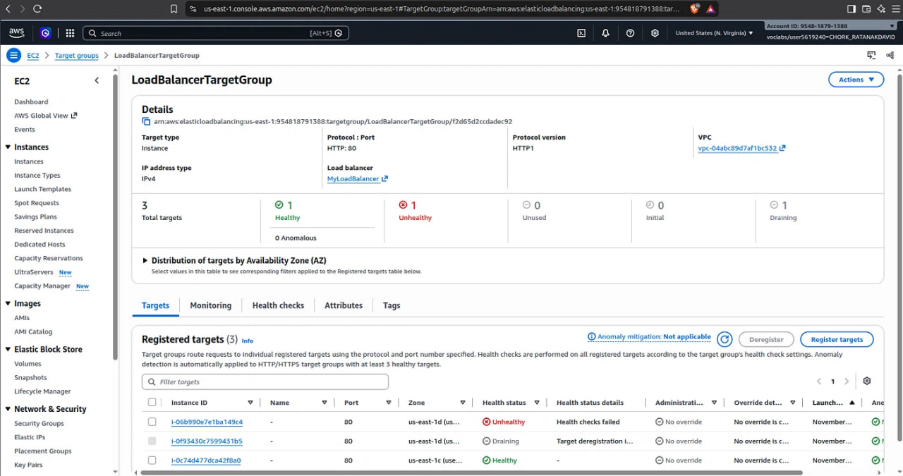

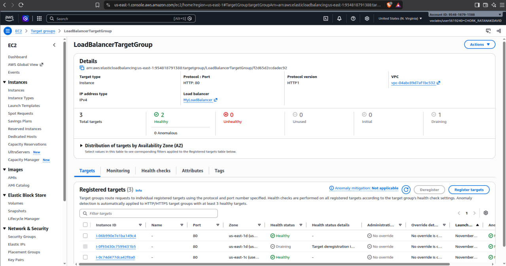

## Questions

1. **Why does the page show a different host name when you refresh it?**
   The Application Load Balancer distributes incoming traffic evenly across all the healthy EC2 instances registered in the target group. When you refresh the page, the load balancer routes your new request to a different instance in the pool, which returns its own unique internal hostname in the HTML file.

2. **After you stopped `httpd`, the instance was still *running* in EC2, but the target group marked it *unhealthy*. What did the health check test, and why did the instance fail it?**
   The target group's health check sends an HTTP GET request to the root path (`/`) on port 80 every 30 seconds. Because the `httpd` service was stopped, the server was no longer listening on port 80 to answer the request. After two consecutive failed attempts, the target group marked the instance as unhealthy.

3. **Who replaced the failed instance: the load balancer, the target group, or the Auto Scaling group? Explain the role of each one.**
   The **Auto Scaling Group** replaced the instance. 
   * The **Load Balancer** simply routes traffic to healthy targets. 
   * The **Target Group** performs the health checks and removes the unhealthy instance from rotation. 
   * The **Auto Scaling Group** monitors the health status (because ELB health checks were enabled) and automatically launches a new EC2 instance to replace the failed one and maintain the desired capacity.

4. **With desired 2, minimum 2 and maximum 3, how many instances run normally? In what situation could there be 3?**
   Normally, exactly **2** instances run. There could temporarily be **3** instances if one instance becomes unhealthy and is being terminated, and the Auto Scaling Group launches a replacement *before* the old one completely shuts down (to avoid downtime). Also, if a scaling policy was added to scale up based on high CPU usage, it would add a 3rd instance up to the maximum limit.

5. **The instances' security group allows HTTP from anywhere. How could you change it so that the instances accept HTTP **only** from the load balancer?**
   You would edit the inbound rules of the `LaunchTemplateSecurityGroup`. Instead of setting the source to `0.0.0.0/0` (Anywhere), you change the source to a **Security Group** and select the `LoadBalancerSecurityGroup`. This ensures that only traffic coming directly from the load balancer can reach the EC2 instances on port 80.

