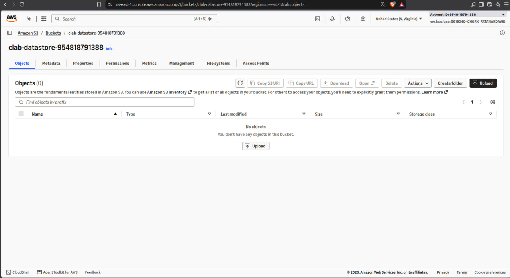
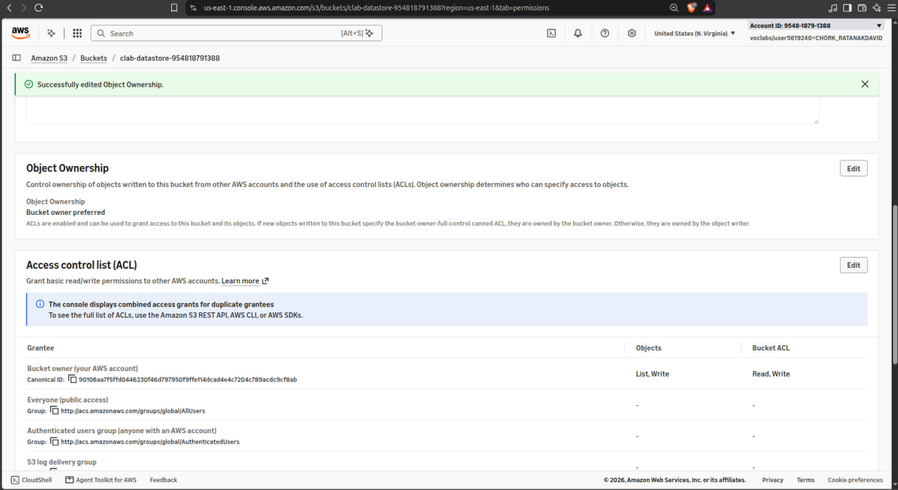
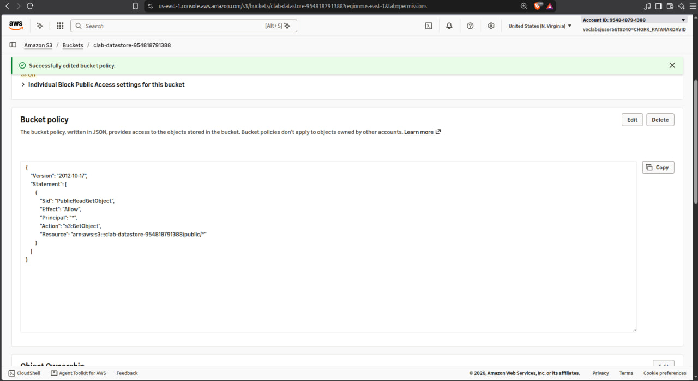
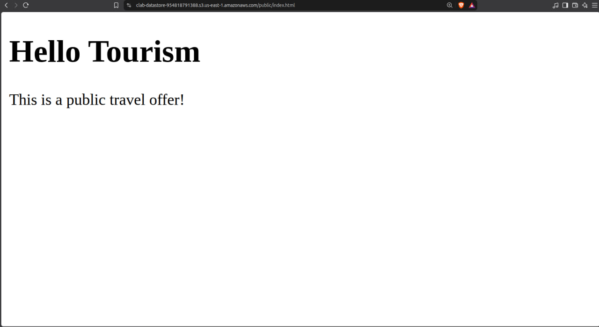
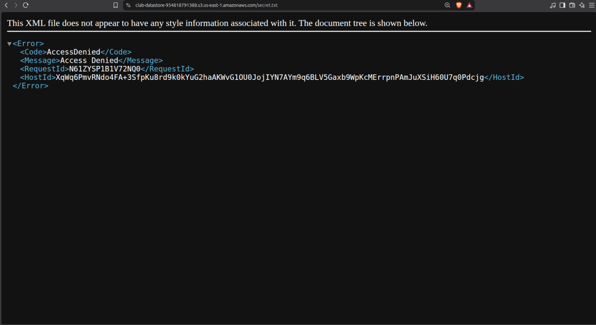
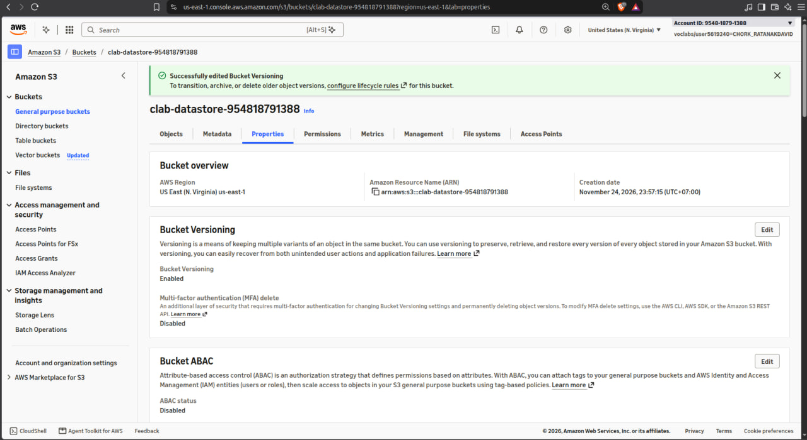
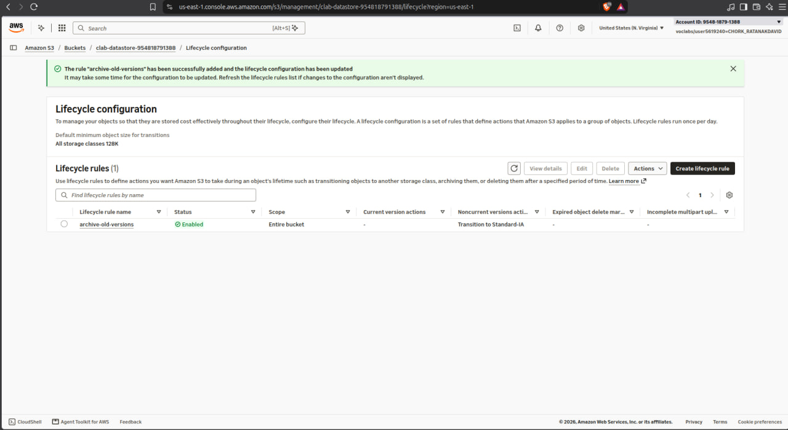

# Cloud Lab 3 Challenge Submission: Secure S3 Bucket

- **Student name:** CHORK RATANAKDAVID
- **Student ID:** e20221642
- **Learner Lab user name:** voclabs/user5619240=CHORK_RATANAKDAVID
- **Bucket name:** clab-datastore-954818791388
- **Date completed:** November 25, 2026

---

## 1. Bucket

## 2. Object ownership

## 3. Public access policy

My policy is in [bucket-policy.json](bucket-policy.json). Explain which line limits public access to the `public/` folder:

**Answer:** The line `"Resource": "arn:aws:s3:::clab-datastore-954818791388/public/*"` limits access. The `public/*` at the end ensures that the `Allow` permission for `s3:GetObject` only applies to objects inside the `public/` folder, keeping everything else private.

## 4. Versioning

## 5. Lifecycle rule

---

## Questions

**1. You turned off parts of Block Public Access for this bucket. Why was that needed, and why is it still safe for the objects outside `public/`?**
Turning off Block Public Access was necessary because AWS blocks all public bucket policies by default. Without turning it off, the policy allowing public read access to the `public/` folder would be ignored. It is still safe for objects outside `public/` because the bucket policy strictly limits the `s3:GetObject` permission to the `public/*` prefix. Any object at the root or in other folders will still be denied.

**2. What is a noncurrent version? Give an example from your own test.**
A noncurrent version is an older version of an object that has been overwritten or replaced by a newer upload. For example, if I uploaded an `index.html` file and then uploaded a new `index.html` to the same folder, the first file becomes the "noncurrent version" and the new one is the "current version".

**3. Why move noncurrent versions to S3 Standard-IA instead of deleting them?**
S3 Standard-IA (Infrequent Access) is significantly cheaper than S3 Standard for storage, but still provides rapid access if the old version is needed. Moving them saves money compared to keeping them in Standard, while still retaining the historical data (unlike deleting them, which would lose the backup).

## AI note (optional)
* An AI tool suggested using `yum` instead of `apt-get` when installing the EFS client, which I verified by checking the operating system header on the terminal.

## Clean up
- [x] All object versions deleted and the bucket deleted.