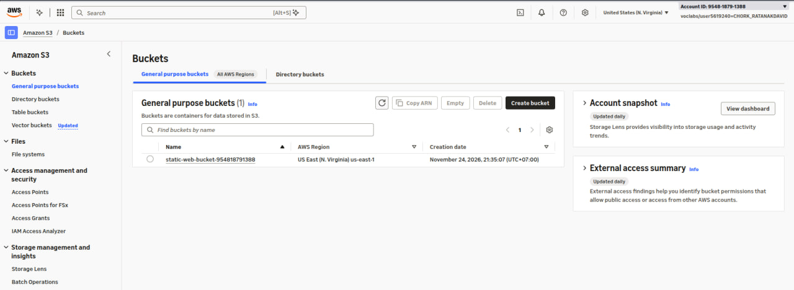
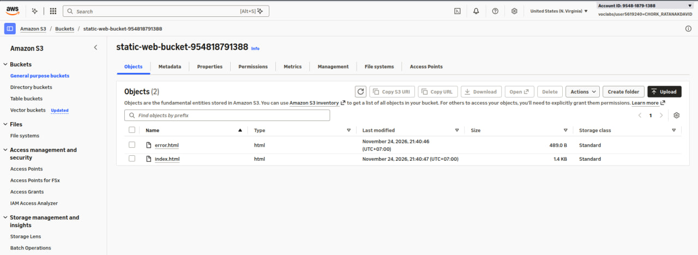
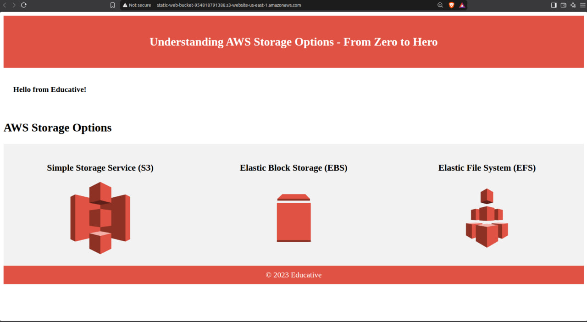
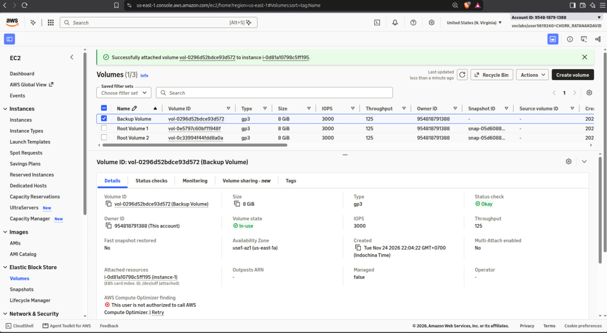
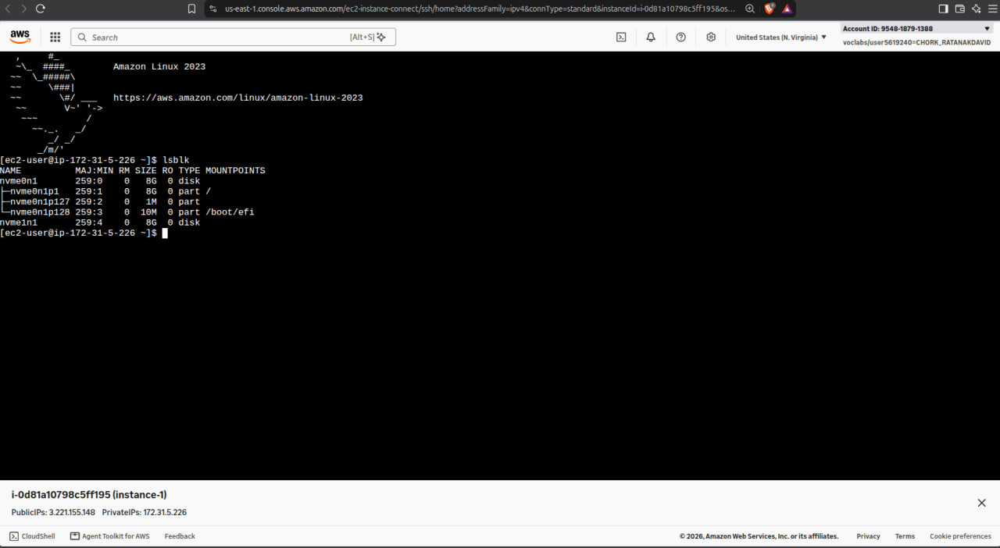
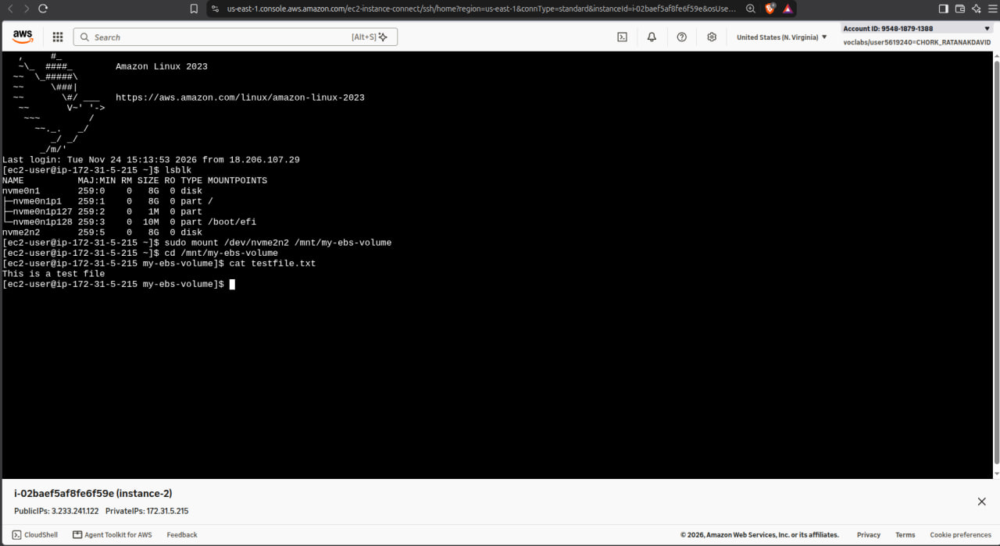
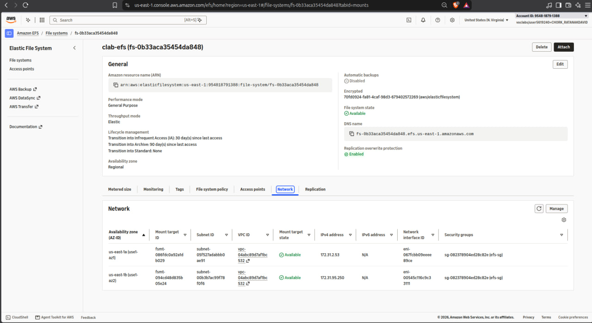
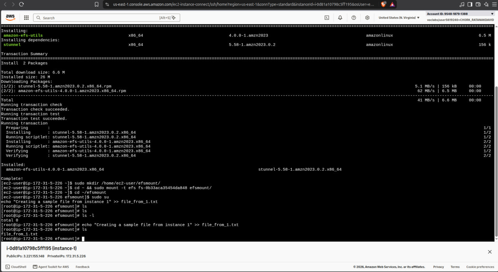
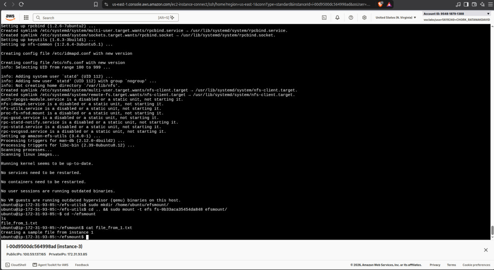

# Cloud Lab 3 Submission: AWS Storage Options
```
- Student name: CHORK RATANAKDAVID
- Student ID: e20221642
- Learner Lab user name: voclabs/user5619240=CHORK_RATANAKDAVID  
- Date completed: November 24, 2026
```


## Part 2.1 — Amazon S3

### Bucket list


### Uploaded files


### Static website


---

## Part 2.2 — Amazon EBS

### Volumes page


### Attached volume (`lsblk`)


Which device name did your volume get (`xvdf`, `nvme1n1`, ...)? 
**Answer:** `nvme2n2` (on instance-1) and `nvme2n2` (on instance-2).

### File read on instance-2


---

## Part 2.3 — Amazon EFS

### File system and mount targets


### File created on instance-1


### File listed on instance-3


---

## Questions

**1. After you turned on static website hosting, the endpoint first answered 403 Forbidden. Why, and what changed after you added the bucket policy?**
The 403 Forbidden error occurred because, by default, S3 buckets block all public access. Turning off "Block Public Access" is not enough to make the objects readable; you must also explicitly grant read permissions. Adding the bucket policy with `"Principal": "*"` and `"Action": "s3:GetObject"` allowed anyone on the internet to read the files, which fixed the error.

**2. `testfile.txt` was still there after you moved Backup Volume to `instance-2`. What would have happened to a file saved on `instance-1`'s root volume after terminating `instance-1`?**
EBS volumes are independent of the instance lifecycle. The `Backup Volume` is an additional volume, so it persists even if the instance is terminated or the volume is detached. However, the **root volume** is set to "Delete on Termination" by default. If you saved a file on `instance-1`'s root volume and then terminated `instance-1`, that file and the root volume would be permanently deleted.

**3. Why did you run `mkfs` on `instance-1` but not on `instance-2`?**
`mkfs` (make file system) formats the raw disk. We ran it on `instance-1` to create an `ext4` file system on the new, empty `Backup Volume`. We did not run it on `instance-2` because formatting the disk again would erase all the data (including `testfile.txt`) that was already on the volume. `instance-2` just needed to mount the existing file system.

**4. Why could `instance-1` and `instance-3` use the EFS file system at the same time, when an EBS volume had to be detached first? Why did they have to be in the subnets of the mount targets?**
* **Simultaneous use:** EFS is a shared file system that uses the NFS protocol, allowing multiple instances to read and write to it at the same time. EBS, on the other hand, is block storage and generally can only be attached to one instance at a time (unless using Multi-Attach on specific volume types).
* **Subnets:** EFS uses **mount targets** which act as endpoints with IP addresses inside specific subnets. An instance must be in the same subnet (or have a route to it) to reach the mount target's IP address and connect to the file system.

**5. For each need, choose S3, EBS or EFS and give one reason:**
* **(a) A website's images:** **S3**. It is highly durable, object storage that can be accessed via HTTP/HTTPS, making it perfect for serving static web content.
* **(b) The disk of a database server:** **EBS**. It provides low-latency block storage that is essential for the high-performance I/O required by a database.
* **(c) A folder shared by several web servers:** **EFS**. It is a shared file system that allows multiple web servers to read and write to the same files simultaneously.

## Problems and how I solved them (optional)
* The `instance-3` initially failed to connect via EC2 Instance Connect due to SSH routing issues in the custom VPC subnet. I solved this by terminating the instance and launching a new one in the default subnet and associating an Elastic IP.
* The EBS volume was initially named `nvme1n1` but after detaching and reattaching, it became `nvme2n2`. I had to check the `lsblk` output each time to ensure I was mounting the correct device.

## AI note (optional)
* An AI tool suggested using `apt-get` on instance-1, but the terminal showed it was actually an Amazon Linux instance. I checked the terminal header and corrected the package manager to `yum`.

## Clean up
- [x] Instances `instance-1`, `instance-2`, `instance-3` terminated.
- [x] `clab-efs` and **Backup Volume** deleted.
- [x] Security groups `efs-sg` and `ec2instances-sg` deleted.
- [x] S3 bucket emptied and deleted.