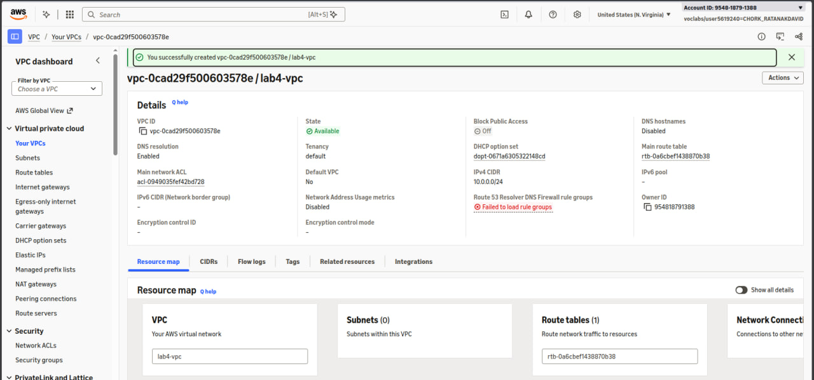
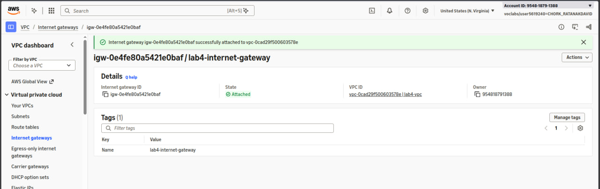
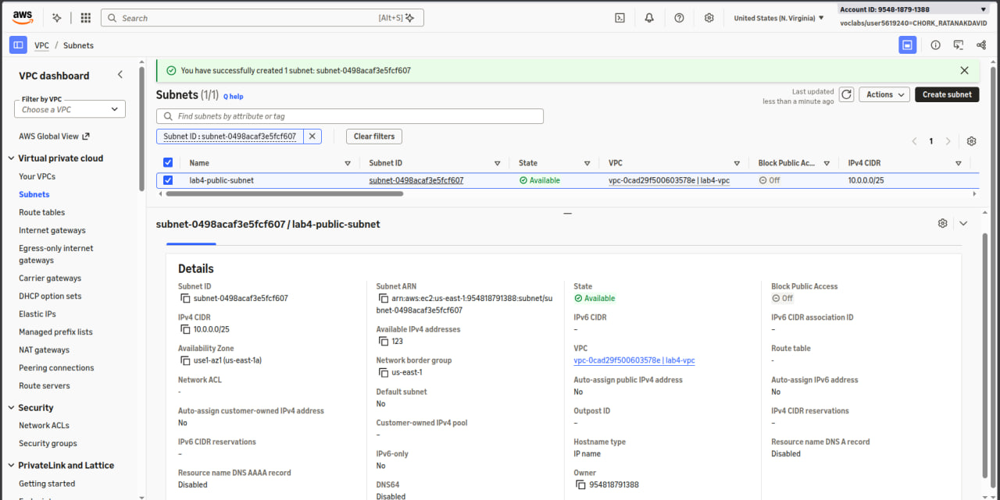
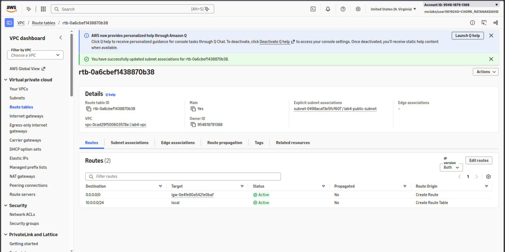
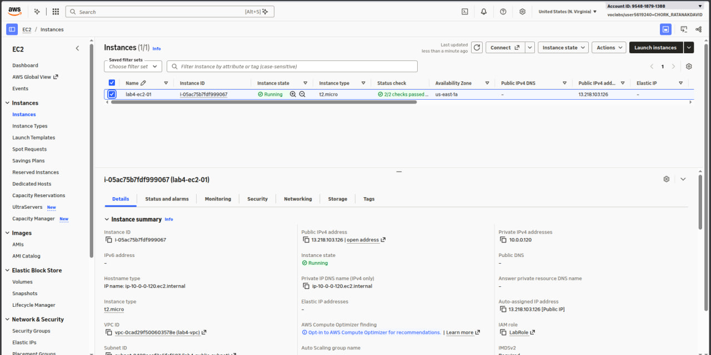
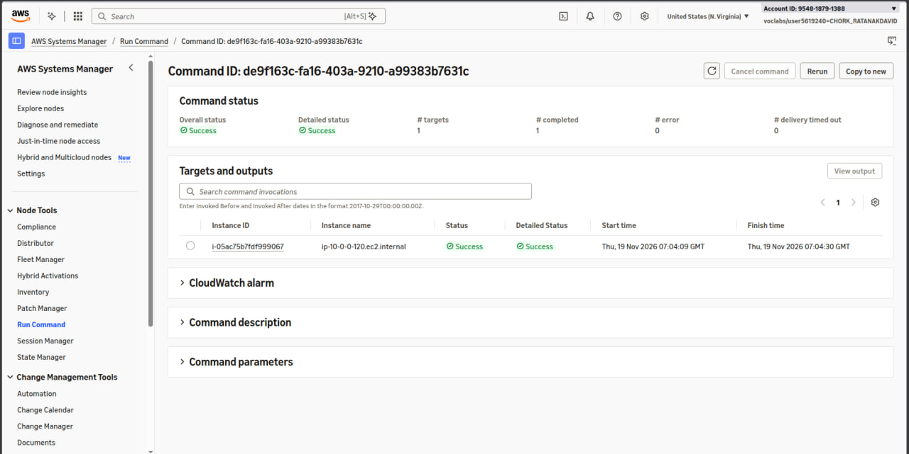
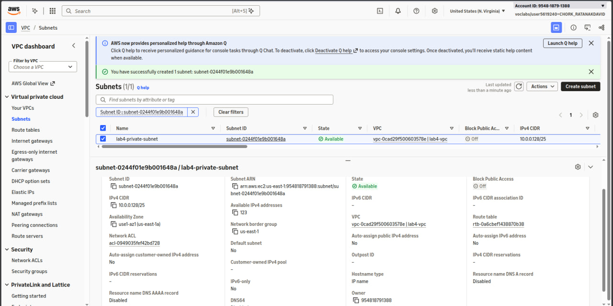
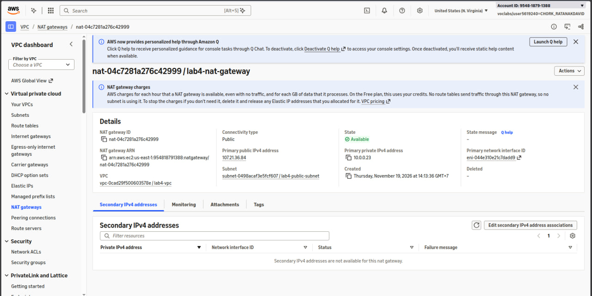
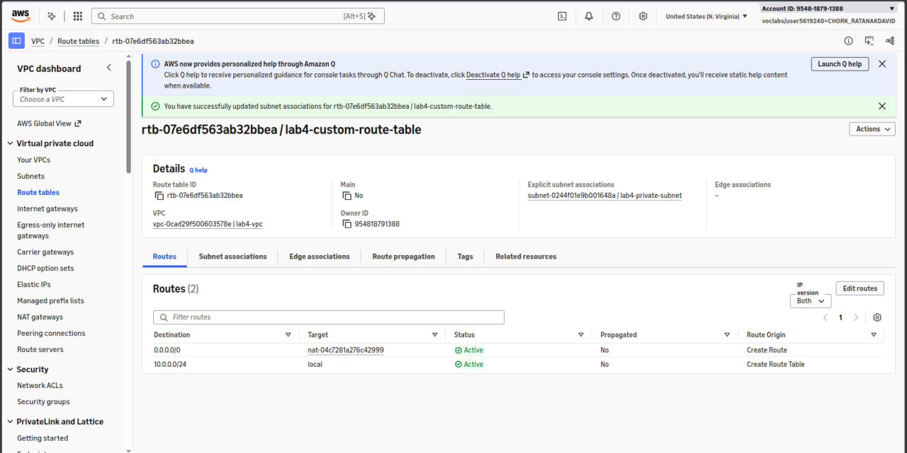
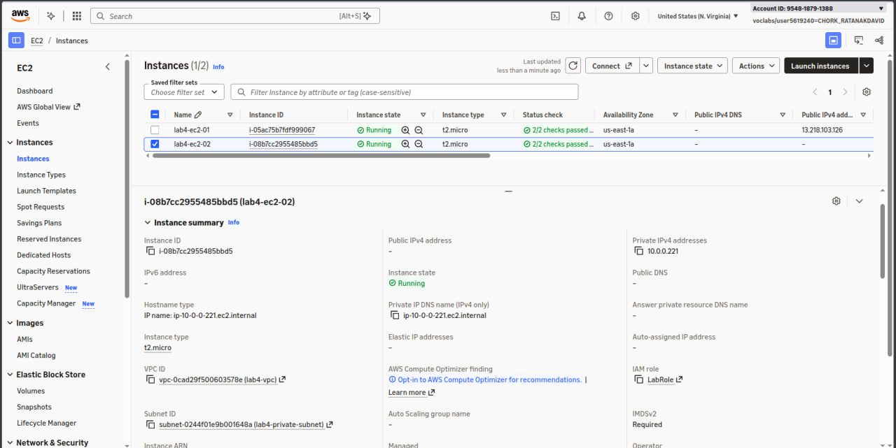

# Cloud Lab 4 Submission — Amazon VPC
```
- **Student name:** CHORK RATANAKDAVID
- **Student ID:** e20221642
- **Learner Lab user name:** voclabs/user5619240=CHORK_RATANAKDAVID
- **Date completed:** November 19, 2026
```


## VPC and internet gateway





## Public subnet









## Private subnet










---

## Questions

**1. The VPC is `10.0.0.0/24` and the subnets are `10.0.0.0/25` and `10.0.0.128/25`. How many IP addresses does each block contain, and why do the two subnets not overlap?**
* **/24 block:** Contains 256 IP addresses (32 - 24 = 8; 2^8 = 256). 
* **/25 block:** Contains 128 IP addresses (32 - 25 = 7; 2^7 = 128).
* **Why they don't overlap:** The VPC (`10.0.0.0/24`) is split exactly in half. The first subnet (`10.0.0.0/25`) covers IP addresses from `10.0.0.0` to `10.0.0.127`. The second subnet (`10.0.0.128/25`) covers IP addresses from `10.0.0.128` to `10.0.0.255`. Because one ends at `.127` and the other begins at `.128`, they do not share any IP addresses.

**2. Both subnets are in the same VPC. What exactly makes `lab4-public-subnet` public and `lab4-private-subnet` private?**
The difference is entirely based on the **route tables** associated with them. The public subnet is associated with a route table that has a route (`0.0.0.0/0`) pointing directly to the **Internet Gateway**, allowing direct communication with the internet. The private subnet is associated with a custom route table that points `0.0.0.0/0` to the **NAT Gateway**, meaning it has no direct path to the internet.

**3. Why is the NAT gateway placed in the public subnet and not in the private one?**
The NAT Gateway acts as a bridge to the internet for the private subnet. It must be placed in the public subnet because the public subnet has a route to the Internet Gateway. If the NAT Gateway were in the private subnet, it would have no way to reach the internet itself, and therefore could not forward traffic for the private instances.

**4. `lab4-ec2-02` has no public IP address. Can someone on the internet open a connection to it? Can it download updates? Explain both answers.**
* **Inbound (Someone connecting to it):** No. Because it has no public IP address and its route table sends traffic to the NAT gateway (not the Internet Gateway), external users have no path to reach it.
* **Outbound (Downloading updates):** Yes. When the instance initiates a connection (like `sudo yum update -y`), the request goes to the NAT Gateway. The NAT Gateway translates the private IP to its own public Elastic IP, sends the request to the internet, and routes the response back to the private instance. 

**5. You tested internet access with Systems Manager instead of SSH. Why did the instances need `LabInstanceProfile` for this?**
Systems Manager (SSM) uses an agent installed on the EC2 instance to communicate with the AWS SSM service. For the agent to authenticate and securely receive commands, the instance needs AWS credentials. The `LabInstanceProfile` provides the instance with an IAM role containing the necessary permissions. It also means we don't need to open SSH ports (Port 22) or use key pairs.

## Problems and how I solved them 
* Example: The NAT Gateway console interface looked different from the lab guide (showing "Regional" instead of "Zonal"). I solved this by switching the availability mode to "Zonal" and manually allocating an Elastic IP so I could select the public subnet.


## Clean up

- [x] Instances terminated.
- [x] NAT gateway deleted and its Elastic IP released.
- [x] Internet gateway detached and deleted.
- [x] `lab4-vpc` deleted.